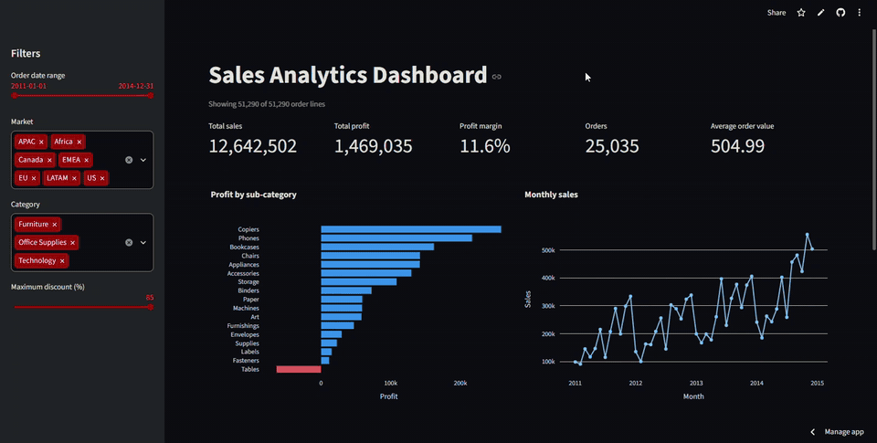

# Sales Analytics Dashboard

An interactive sales dashboard built with **Streamlit** and **Plotly**, for the **CodeNova Internship Program (Batch 01, Data Science), Task 3**.

Filter 51,290 order lines (2011 to 2014) by date, market, category and discount, and watch the KPI cards and charts update instantly.

**Live demo:** https://codenova-sales-dashboard.streamlit.app



## Features

- **Dynamic filters** (sidebar)
  - Order date range slider
  - Market dropdown (multi-select)
  - Category dropdown (multi-select)
  - Maximum discount threshold slider (0 to 85%)
- **KPI cards** that update with every filter change: total sales, total profit, profit margin, number of orders, average order value
- **Interactive charts** (hover, zoom, pan)
  - Bar chart: profit by sub-category (loss-making sub-categories shown in red)
  - Line chart: monthly sales trend
  - Scatter plot: discount vs profit, by category
- **Graceful empty state:** if the filters match nothing, the dashboard shows a friendly "No matching records" message instead of an error
- **Responsive layout** with a sidebar for filters and a wide main area for KPIs and charts

## Default view (no filters)

| KPI | Value |
|---|---|
| Total sales | 12,642,502 |
| Total profit | 1,469,035 |
| Profit margin | 11.6% |
| Orders | 25,035 |
| Average order value | 504.99 |

## Tech Stack

Python 3, Streamlit, Plotly Express, pandas, NumPy. All free and open source; hosted on Streamlit Community Cloud (free tier).

## Project Structure

```
codenova-ds-analytics-dashboard/
├── app.py                          # Streamlit app (filters, KPIs, charts)
├── prepare_data.py                 # Builds the dashboard CSV from the source Excel file
├── requirements.txt
├── data/
│   └── superstore_dashboard.csv    # Modified data used by the app (see Data)
├── docs/
│   └── dashboard_demo.gif          # Demo walkthrough
├── DATA_LICENSE.md                 # Data attribution and licence notice
├── LICENSE-DATA.txt                # Full CDLA-Sharing-1.0 text
├── .gitignore
└── README.md
```

## Setup and Run Locally

1. Clone the repository and install the requirements:
   ```
   git clone https://github.com/Acykhin247/codenova-ds-analytics-dashboard.git
   cd codenova-ds-analytics-dashboard
   pip install -r requirements.txt
   ```
2. Start the app:
   ```
   python -m streamlit run app.py
   ```
3. Open http://localhost:8501 in your browser.

**Optional: rebuild the data file.** `prepare_data.py` recreates `data/superstore_dashboard.csv` from the original `superstore_sales.xlsx` (not included in this repository; download it from the source below and place it in a `source/` folder). It also needs `openpyxl`.

## Data

- **Dataset:** [Superstore Sales Dataset on Kaggle](https://www.kaggle.com/datasets/amirmotefaker/superstore-sales-dataset), published by Kaggle user `amirmotefaker`
- **License:** Community Data License Agreement – Sharing, Version 1.0 ([CDLA-Sharing-1.0](https://cdla.dev/sharing-1-0/)); full text in `LICENSE-DATA.txt`
- **Changes made:** `data/superstore_dashboard.csv` is a **modified version** of the "Orders" sheet of `superstore_sales.xlsx`: 12 of the 21 columns were kept (order_id, order_date, market, region, country, category, sub_category, segment, sales, quantity, discount, profit), dates were converted to YYYY-MM-DD, and the file was saved as CSV. No rows were removed or edited (51,290 rows). See `DATA_LICENSE.md`.

This modified file is shared under the same license. The code in this repository is separate from the data. This project is an independent educational exercise and is not endorsed by the dataset's publisher.

## Notes and Limitations

- **Currency is not stated** in the source data, so no currency symbol is shown.
- **Sales appear to be net of discounts.** This is inferred from the data (unit prices are more consistent once the discount is divided out), not stated by the source.
- **"Orders" counts distinct order IDs.** A small number of order IDs are reused by different customers on different dates, so order counts and average order value are approximate.
- **The scatter plot shows a random sample** of up to 5,000 order lines, slightly jittered horizontally so overlapping points stay visible. Its profit axis is zoomed to the middle 98% of values, so about 2% of extreme values are not shown.
- **Association, not cause:** the dashboard shows that higher discounts go with lower profit. It does not prove that discounts cause the losses.
- The free hosting tier may put the app to sleep when it has not been visited for a while; opening the link wakes it.

## Author

**Clement Yaw Amegashie**
BSc Information Technology, University of Professional Studies, Accra (UPSA)

Built as part of the CodeNova Internship Program, Batch 01.
